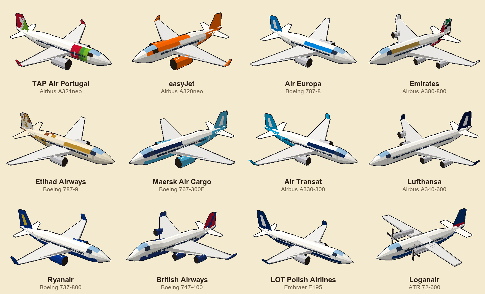

# skywatch-cyd

**Nearby flights on a €15 touchscreen: standalone, no server.** An ESP32-2432S028 ("Cheap Yellow
Display") fetches the aircraft around you from open ADS-B data and shows them one at a time: airline,
type, route, altitude, speed, distance, a compass, and a shaded 3D model in the airline's livery
(or a photo of that exact plane). The board's RGB LED glows in the airline's colour.



<sub>Twelve airlines on twelve aircraft types, rendered on the host from the same 3D code that runs on the board, so the shapes and liveries match; the real screen is 320×240 and looks smaller and blockier.</sub>

## Features
- **Carousel** of the nearest aircraft (default 40 km), touch to skip ahead. 20 s data refresh.
- **Per-plane details:** callsign, airline, type, altitude / FL, speed and track, distance and
  bearing, **route** (origin > destination), compass with the direction of travel.
- **3D models** built on the board from real dimensions of ~110 types (A220–A380, 737–787, E-Jets, CRJ,
  ATR, Dash 8, business jets, light aircraft, helicopters), adapted per family (nose and tail shape,
  engine size, raked 777/787 tips, T-tails, winglet styles) with windows, doors, landing gear when low
  and slow, and the 747 hump / A380 double deck.
- **Liveries** for ~160 airlines: fuselage scheme, tail designs (disc, stripes, diagonal, checker,
  cross, faceted, flag stripes…), tinted fuselages, engine and winglet colours, plus airline-specific
  paint such as TAP's logo block, easyJet's orange crown and Etihad's gold facets.
- **Photos** of the actual aircraft from planespotters.net by registration (photographer credited),
  with the 3D model as fallback.
- **RGB LED** in the airline's colour; airlines with two real colours (Ryanair, TAP…) hold and fade
  between them.
- **Night mode:** screen and LED off on a schedule, touch to wake for 10 min (`set wake <minutes>`). `flights` over serial lists the detected aircraft.
- **Location from your IP** (city level) or a fixed one.
- **Robust:** WiFi watchdog, hardware watchdog, restarts if stuck, out of memory, or once a day.

## Hardware
One **ESP32-2432S028R** (2.8" ILI9341, resistive touch, RGB LED, light sensor) and a micro-USB
cable, roughly €15–25. Capacitive "IPS" variants use different touch pins and are not supported.

## Install (flash the prebuilt firmware)
No toolchain needed: download the binary from [Releases](https://github.com/joao-m-ferreira/skywatch-cyd/releases)
and write it to the board over USB.

1. From the latest release download **`skywatch-cyd-<version>-merged.bin`** (and `SHA256SUMS` to check it:
   `shasum -a 256 -c SHA256SUMS`).
2. Plug the board in with a micro-USB **data** cable and find its port: macOS `/dev/cu.wchusbserial*`
   (or `/dev/cu.usbserial*`), Linux `/dev/ttyUSB0`, Windows `COM3`. If no port appears, install the
   CH340 USB driver.
3. Flash it, either with `esptool` (`pip install esptool`):

   ```sh
   # first install: one file at 0x0 (also erases saved settings)
   esptool.py --chip esp32 --port <port> --baud 460800 write_flash 0x0 skywatch-cyd-<version>-merged.bin
   # update an installed board: the app only (keeps your WiFi and settings)
   esptool.py --chip esp32 --port <port> --baud 460800 write_flash 0x10000 skywatch-cyd-<version>-firmware.bin
   ```

   or from the browser (Chrome/Edge, nothing to install): open
   [Espressif's web flasher](https://espressif.github.io/esptool-js/), connect, set the address to `0x0`,
   pick the `-merged.bin` file and press Program.
4. If the upload cannot connect, hold the **BOOT** button while it starts, then release it.
5. Open a serial terminal at **115200 baud** (`screen /dev/cu.wchusbserial* 115200`, Arduino serial
   monitor, …), type `help`, and set your WiFi:

   ```
   set ssid <your WiFi>
   set pass <password>
   ```

The screen shows the planes around you within about a minute. The location comes from your public IP;
use `set location static <lat> <lon>` for an exact one.

## Settings (USB serial, 115200 baud)
Settings are saved in the board's flash. The build-time defaults come from `secrets.h`.

| Command | What it does |
|---|---|
| `show` / `status` | current settings (password hidden) / uptime, memory, WiFi, clock |
| `set ssid <name>` / `set pass <password>` | WiFi (`set pass -` for an open network) |
| `set location auto` | locate from your public IP via geojs.io (default) |
| `set location static <lat> <lon>` | fixed position (also `set lat` / `set lon`) |
| `set radius <km>` | search radius, 1–250 |
| `set contact <email>` | contact sent to planespotters.net (required by their API) |
| `set night <from> <to>` / `set night off` | screen off between these hours, e.g. `set night 23 7` |
| `set tz <posix tz>` | clock timezone (found from your location when auto) |
| `set panel ili9341\|st7789` / `set invert on\|off` / `set rgb normal\|swap` / `set rotation 1\|3` | board variant: panel, colour inversion, red/blue order, upside-down (restarts to apply) |
| `display test` | colour test card for 15 s, to identify your panel variant |
| `set led <0..100>` | RGB LED brightness percent |
| `safe on\|off` | force / leave safe mode |
| `night test` | try night mode for 20 s (not saved) |
| `reboot` / `factory` | restart / forget saved settings |

## Board variants and troubleshooting
The "Cheap Yellow Display" is sold with the same pinout but different panels. The default matches the
single-USB **ESP32-2432S028R** (ILI9341). If colours are wrong on your board, run `display test` and
compare the bars with red, green, blue, white, black, yellow, cyan, magenta:

| You see | Do |
|---|---|
| red and blue swapped | `set rgb swap` |
| colours look like a negative | `set invert on` (or `off`) |
| upside down | `set rotation 3` |
| white or garbled screen, two USB ports (micro + USB-C) | `set panel st7789`, then `set invert on` if needed |

The board restarts to apply each display setting and remembers it. Boards with capacitive touch or
other screen sizes use different pins and are not supported.

`status` shows why the board last restarted (power on, software, panic, watchdog, **brownout**), the
largest free block of memory and the number of crashes in a row. A **brownout** usually means a weak
USB port or cable: try another port, or lower the LED with `set led 30`. After three crashes in a row
the board starts in **safe mode** (no photos, no 3D model, text only) so it can still be reached;
five stable minutes, or `safe off`, bring it back to normal.

## Build from source
Needs `arduino-cli`, Go (optional proxy only), and the ESP32 core.

```sh
scripts/setup.sh        # core + libraries, creates firmware/jf_flight_display/secrets.h
# edit secrets.h (WiFi, contact) or configure over serial after flashing
scripts/lint.sh && scripts/test.sh && scripts/build.sh
arduino-cli upload -p <port> --fqbn esp32:esp32:esp32:PartitionScheme=huge_app --input-dir build/firmware
```
`scripts/test.sh` runs host-side tests for the parsing, aircraft table, 3D meshes, airline table and
serial commands. See [CONTRIBUTING.md](CONTRIBUTING.md) and [docs/ARCHITECTURE.md](docs/ARCHITECTURE.md).

## Releases
Versions follow [Semantic Versioning](https://semver.org/) and live as git tags (`v0.1.0`); the
firmware reports its version at boot and in `status`.

1. Add a section to [CHANGELOG.md](CHANGELOG.md) and write `docs/releases/<version>.md`.
2. Merge to `main` and wait for CI to pass.
3. Run `scripts/tag-release.sh <version>`: it checks everything, then pushes the tag.
4. The Release workflow builds the binaries from a clean checkout (no secrets), verifies them, and
   publishes `skywatch-cyd-<version>-merged.bin`, `-firmware.bin` and `SHA256SUMS`.

## Data sources and credits
- Aircraft positions: [adsb.fi](https://adsb.fi) open data (personal, non-commercial use).
- Routes: [adsbdb](https://www.adsbdb.com) (community data: can be wrong or missing).
- Photos: [planespotters.net](https://www.planespotters.net), credited on screen to each photographer.
- Location: [geojs.io](https://www.geojs.io) (sends your public IP; use a static location to avoid it).
- Inspired by [suvl/ledmatrix](https://github.com/suvl/ledmatrix) and
  [dmellok/tesserae-widget-overhead](https://github.com/dmellok/tesserae-widget-overhead); no code was
  copied from either.

## Limits
No airline logos or lettering (trademarks, and the screen is too small), no AI-painted images, no
weather. Liveries and colours are approximations. The optional Go service in `service/` is a simple
proxy the firmware does not use. No licence has been chosen yet.
