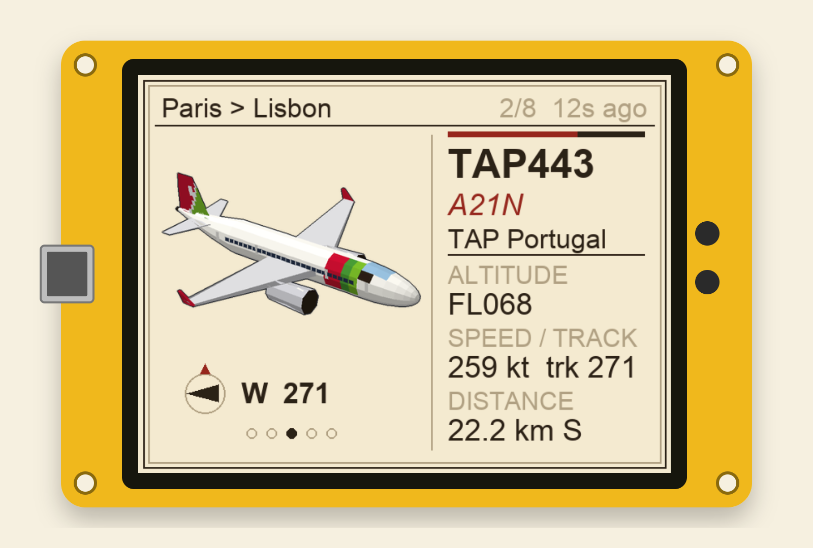

# skywatch-cyd

**Nearby flights on a €15 touchscreen: standalone, no server.** An ESP32-2432S028 ("Cheap Yellow
Display") fetches the aircraft around you from open ADS-B data and shows them one at a time: airline,
type, route, altitude, speed, distance, a compass, and a shaded 3D model in the airline's livery
(or a photo of that exact plane). The board's RGB LED glows in the airline's colour.

**[Open the web portal](https://joao-m-ferreira.github.io/skywatch-cyd/)** to flash a board from your browser in a minute, with nothing to install.

<p align="center"></p>
<p align="center"><sub>What the screen shows (illustration). The 3D aircraft is drawn by the firmware itself, in the airline's colours.</sub></p>

Every aircraft type gets its own shape and every airline its own paint:


<sub>Twelve airlines on twelve aircraft types, rendered on the host from the same 3D code that runs on the board, so the shapes and liveries match; the real screen is 320×240 and looks smaller and blockier. Regenerate with `python3 scripts/readme_image.py`.</sub>

## Features
- **Carousel** of the nearest aircraft (default 40 km, at most 10: `set max`), touch to skip ahead. 6 s per plane (`set plane <seconds>`). 20 s data refresh.
- **Per-plane details:** callsign, airline, type, altitude / FL, speed and track, distance and
  bearing, **route** (origin > destination), compass with the direction of travel.
- **3D models** built on the board from real dimensions of ~110 types (A220–A380, 737–787, E-Jets, CRJ,
  ATR, Dash 8, business jets, light aircraft, helicopters), adapted per family (nose and tail shape,
  engine size, raked 777/787 tips, T-tails, winglet styles) with windows, doors, landing gear when low
  and slow, and the 747 hump / A380 double deck.
- **Liveries** for ~160 airlines: fuselage scheme, tail designs (disc, stripes, diagonal, checker,
  cross, faceted, flag stripes…), tinted fuselages, engine and winglet colours, plus airline-specific
  paint such as TAP's logo block, easyJet's orange crown and Etihad's gold facets.
- **Photos** of the actual aircraft from planespotters.net by registration (photographer credited),
  with the 3D model as fallback.
- **RGB LED** in the airline's colour; airlines with two real colours (Ryanair, TAP…) hold and fade
  between them.
- **Night mode:** screen and LED off on a schedule, touch to wake for 10 min (`set wake <minutes>`). `flights` over serial lists the detected aircraft.
- **WiFi setup mode:** with no WiFi saved (or none reachable for 3 minutes) the board opens its own WiFi and a settings page, with a QR code and the password on its screen.
- **Web page and MCP server** on the board's own address, on by default, protected by an access token, each with its own off switch; the MCP tools are read-only (see [Web page and MCP server](#web-page-and-mcp-server)).
- **Boards:** ESP32 (touchscreens, small colour screens, text OLEDs, an AMOLED) and the ESP8266 with a text OLED.
- **Small screens:** the TTGO T-Display (240x135) and the M5StickC (160x80) show the plane and one value at a time (distance, altitude, speed).
- **Location from your IP** (city level) or a fixed one.
- **Robust:** WiFi watchdog, hardware watchdog, restarts if stuck, out of memory, or once a day.

## Hardware
One **ESP32-2432S028R** (2.8" ILI9341, resistive touch, RGB LED, light sensor) and a micro-USB
cable, roughly €15–25. Capacitive "IPS" variants use different touch pins and are not supported.

## Install (flash the prebuilt firmware)
**Easiest: from your browser.** Open the [web portal](https://joao-m-ferreira.github.io/skywatch-cyd/), choose your board, press **Install**, then type your
WiFi name and password into the page: it sends them to the board over the USB cable. You need Chrome or Edge
on a computer and a USB *data* cable, and nothing else. The portal is published from this repository's latest
release (see [Web portal](#web-portal)).

**Or by hand**, with the files from [Releases](https://github.com/joao-m-ferreira/skywatch-cyd/releases):
there is one pair of files per board, named `skywatch-cyd-<version>-<board>-merged.bin` (everything, flash at
`0x0`) and `-firmware.bin` (the app only, flash at `0x10000`, keeps your settings).

| Board | `<board>` | Chip | Status |
|---|---|---|---|
| ESP32-2432S028R "Cheap Yellow Display" 2.8" (ILI9341, one USB port) | `cyd` | ESP32 | tested on real hardware |
| 2.8" CYD with two USB ports (ST7789) | `cyd-st7789` | ESP32 | not tested on hardware |
| 3.5" "big CYD" (ST7796, 480x320) | `cyd35` | ESP32 | experimental |
| LilyGO TTGO T-Display (1.14" ST7789, 240x135) | `ttgo-tdisplay` | ESP32 | tested on real hardware |
| M5StickC (original, 0.96" 160x80) | `m5stickc` | ESP32 | tested on real hardware |
| Waveshare ESP32-S3-Touch-AMOLED-1.8 | `amoled18` | ESP32-S3 | emulator only |
| Any ESP32 + 0.96" SSD1306 OLED module (text only, I2C on GPIO 21/22) | `oled96` | ESP32 | not tested |
| ESP32 board with the 0.96" OLED built in (Wemos/TTGO style, GPIO 5/4) | `oled96-onboard` | ESP32 | experimental |
| ESP8266 board with the 0.96" OLED built in (ESP-12 style, GPIO 14/12) | `esp8266-oled` | ESP8266 | experimental (tested on one board) |

1. Download the `-merged.bin` for your board (and `SHA256SUMS` to check it:
   `shasum -a 256 -c SHA256SUMS`).
2. Plug the board in with a micro-USB **data** cable and find its port: macOS `/dev/cu.wchusbserial*`
   (or `/dev/cu.usbserial*`), Linux `/dev/ttyUSB0`, Windows `COM3`. If no port appears, install the
   CH340 USB driver.
3. Flash it, either with `esptool` (`pip install esptool`):

   ```sh
   # first install: one file at 0x0 (also erases saved settings); use --chip esp32s3 for the AMOLED board
   esptool.py --chip esp32 --port <port> --baud 460800 write_flash 0x0 skywatch-cyd-<version>-<board>-merged.bin
   # update an installed board: the app only (keeps your WiFi and settings)
   esptool.py --chip esp32 --port <port> --baud 460800 write_flash 0x10000 skywatch-cyd-<version>-<board>-firmware.bin
   ```

   or with Espressif's browser flasher: open [esptool-js](https://espressif.github.io/esptool-js/), connect, set
   the address to `0x0`, pick the `-merged.bin` file and press Program.
4. If the upload cannot connect, hold the **BOOT** button while it starts, then release it.
5. Open a serial terminal at **115200 baud** (`screen /dev/cu.wchusbserial* 115200`, Arduino serial
   monitor, …), type `help`, and set your WiFi:

   ```
   set ssid <your WiFi>
   set pass <password>
   ```

The screen shows the planes around you within about a minute. The location comes from your public IP;
use `set location static <lat> <lon>` for an exact one.

You can also skip the serial terminal: a board with no WiFi saved starts its own [setup WiFi](#wifi-setup-mode).

## Settings (USB serial, 115200 baud)
Settings are saved in the board's flash. The build-time defaults come from `secrets.h`.

| Command | What it does |
|---|---|
| `show` / `status` | current settings (password hidden) / uptime, memory, WiFi, clock |
| `set ssid <name>` / `set pass <password>` | WiFi (`set pass -` for an open network) |
| `set location auto` | locate from your public IP via geojs.io (default) |
| `set location static <lat> <lon>` | fixed position (also `set lat` / `set lon`) |
| `set radius <km>` | search radius, 1–250 |
| `set max <planes>` | most planes shown, nearest first, 1–20 (default 10) |
| `set plane <seconds>` | how long each plane stays on screen, 3–120 (default 6); small screens split it between distance, altitude and speed |
| `set contact <email>` | contact sent to planespotters.net (required by their API) |
| `set night <from> <to>` / `set night off` | screen off between these hours, e.g. `set night 23 7` |
| `set tz <posix tz>` | clock timezone (found from your location when auto) |
| `set panel ili9341\|st7789\|st7796\|ili9488\|tdisplay\|m5stickc` / `set invert on\|off` / `set rgb normal\|swap` / `set rotation 0..3` | board variant: panel, colour inversion, red/blue order, orientation (restarts to apply) |
| `set backlight <gpio>` / `set touch separate\|shared` | 3.5" boards: backlight pin (27) and touch on the display's SPI bus (restarts to apply) |
| `set layout auto\|side\|flip\|stacked` | plane left / plane right / plane on top, text below (auto by panel shape) |
| `display test` | colour test card for 15 s, to identify your panel variant |
| `set led <0..100>` | RGB LED brightness percent |
| `safe on\|off` | force / leave safe mode |
| `night test` | try night mode for 20 s (not saved) |
| `set web on\|off` / `set mcp on\|off` | the web page / the MCP server on the board's address (default on; both need the access token) |
| `set mcpauth on\|off` | require the token in a header for `/mcp` (`Authorization: Bearer <token>` or `X-API-Key: <token>`); default off |
| `set advertise on\|off` | announce the board on the network (`skywatch.local`, `_mcp._tcp`) and serve the public Server Card (default on) |
| `token` / `token new` | show the access token / make a new one |
| `setup` | open the WiFi setup page now (see below) |
| `version` / `update` | firmware version, build date and board / check GitHub for a newer release (needs WiFi) |
| `reboot` / `factory` | restart / forget saved settings |

## The 0.96" OLED version
The same firmware also runs on a tiny **128x64 monochrome OLED** (SSD1306, I2C). It shows the same facts as
text, with no 3D model, photo, compass, LED or touch: callsign and type, the airline, altitude and speed,
and the distance with the bearing and the plane's heading. When the route is known it alternates with the airline row. The planes rotate by themselves; the board's
**BOOT** button shows the next one. The wiring is `VCC`, `GND`, `SDA` (GPIO 21) and `SCL` (GPIO 22); for
other pins use `set i2c <sda> <scl>`, and `set panel ssd1306` selects the display on a board flashed with
another build. Not tested on hardware.

## WiFi setup mode
A board with no WiFi saved, or one that cannot reach its WiFi for 3 minutes (new router, changed password), opens
its **own WiFi** named `skywatch-XXXX` with a random one-time password, and shows on its screen how to join it:
a QR code (phones join by scanning it), the network name, the password and the address `192.168.4.1`. A phone
opens the settings page by itself; if not, browse to `http://192.168.4.1/`. There you choose your WiFi, location,
radius, seconds per plane and night mode; every value is checked before it is saved. The board keeps trying the
saved WiFi meanwhile, and leaves setup mode on its own once it is connected. To start it by hand: `setup` over
serial, or hold the board's button for 3 seconds on the T-Display, M5StickC and OLED boards.

## Web page and MCP server
The full reference (routes, the JSON API, every MCP tool and error, discovery and troubleshooting) is in
[docs/network-interfaces.md](docs/network-interfaces.md); this is the short version.

Both are **on by default** and each has its own switch (and a third one for the announcement, below): `set web off`,
`set mcp off` and `set advertise off` over serial, or the three selects in the setup page and the tick boxes in the
portal's setup form (More settings). The first time either is on, the board makes an **access token** and prints it
(`token` shows it again, `token new` replaces it). The web page, its JSON and the settings page **always** need the
token. The MCP endpoint needs it only when you switch header authentication on with `set mcpauth on` (**off by
default**): until then anyone on your network can read the planes and the board's status through MCP. That is all
they can do, because the tools are read-only. The connection is plain HTTP, so treat the board as a local-network
service, never an internet one (do not forward its port). To close the port completely, switch both off.

| Address | What | Needs |
|---|---|---|
| `http://skywatch.local/` | the planes (refreshing) and a link to the settings | web on; user `skywatch`, the token as password |
| `/api/flights`, `/api/status` | the same data as JSON | web on, same login |
| `/settings` | the setup form, to change WiFi, location, radius... | web on, same login |
| `/mcp` | MCP over HTTP (JSON-RPC 2.0): `initialize`, `tools/list`, `tools/call` | MCP on; with `set mcpauth on`, the header `Authorization: Bearer <token>` or `X-API-Key: <token>` |

The MCP tools are **read-only**: `get_nearby_flights` (optional `limit`), `get_current_plane` and `get_status`. Nothing
can change a setting through MCP, and `get_status` never includes the WiFi password, the token or your position.
Browser requests to `/mcp` (anything with an `Origin` header) are refused, and five wrong tokens in a row lock the
board out for a minute (a request with no token at all does not count). Point an MCP client at the URL; with header authentication on, give
it the header too. A client that takes a JSON configuration looks like this (the exact keys differ between clients):

```json
{ "mcpServers": { "skywatch": { "url": "http://skywatch.local/mcp", "headers": { "Authorization": "Bearer <token>" } } } }
```

Leave `headers` out while header authentication is off (the default).

**Discovery** (`set advertise on`, the default; `set advertise off` hides the board, which restarts once to withdraw its name and then answers on its IP address only). The board announces itself over mDNS as `skywatch.local` and, with MCP on, over DNS-SD as `_mcp._tcp` (port 80; TXT `path=/mcp`,
`card=/mcp/server-card`, `auth=bearer` or `none`, `version`), so `dns-sd -B _mcp._tcp` (macOS) or `avahi-browse _mcp._tcp`
(Linux) finds it. It also serves a public MCP **Server Card** at `/mcp/server-card` (media type
`application/mcp-server-card+json`: name, version, the endpoint, the headers it needs when `mcpauth` is on, and the protocol
version) and an AI Catalog at `/.well-known/ai-catalog.json` that points to it. Both are public by design and hold
no secret: never the token, never your WiFi or position. The `_mcp._tcp` service name is a convention, not a standard,
and current MCP clients do not browse for servers themselves: use the address
above, or a script that browses and writes your client's config.

This part is tested in the esp32sim emulator (`scripts/emu-web.sh`: about 40 checks over the board's forwarded port, including a run longer than 10 minutes) and
by host tests, not yet on a real board.

## Small colour screens
The **TTGO T-Display** (`set panel tdisplay`, 240x135) and the **M5StickC** (`set panel m5stickc`, 160x80) have
no room for the full plate, so they show the 3D plane (or photo), the compass and heading, the callsign and type,
and **one value at a time**, rotating through distance, altitude, speed and, when it is known, the **route** (origin to destination; airport codes on the 160x80 screen); each plane starts at distance. The time
per plane (`set plane`) is split between the three. Neither board has a touch screen: the button (T-Display: left
button, GPIO 0; M5StickC: button A, GPIO 37) shows the next plane. The M5StickC's screen is powered through its
AXP192 chip, which the firmware sets up; the C Plus and Plus2 have other screens and are not supported yet.

## ESP8266 with an OLED
The small **ESP8266** boards with a built-in 0.96" OLED (ESP-12 style, the screen on SDA GPIO 14 and SCL GPIO 12) run a
separate, smaller build (`esp8266-oled`) that shares the flight parsing, the OLED text and the serial commands with the
ESP32 build (`firmware/skywatch_esp8266/`; `scripts/stage_esp8266.sh` gathers the shared files next to it, because the
Arduino tools compile a copy of the sketch folder). It shows the same four text rows (the airline row alternates with the route as airport codes, for example `LIS > YYZ`, looked
up once per flight on adsbdb.com) and the FLASH button shows the next plane; the serial settings (`set ssid`, `set radius`, `set plane`, `set night`...) and the browser setup in the portal
work as on the other boards. It has **no 3D model, photos or WiFi setup page**, but it does serve the **web page, JSON API and
MCP server** and announces itself over mDNS like the ESP32 builds ([Network interfaces](docs/network-interfaces.md)), with smaller
limits. The chip has about 80 KB of RAM: the TLS connection to the data source needs a 6 KB receive buffer plus about 7 KB more
(the servers refuse small TLS records), and the web server and mDNS take their share, so roughly 24 KB are free when idle and
10 KB while it fetches. If a board reports "Not enough memory for TLS", `set web off` and `set mcp off` give the memory back. The
image is one file flashed at `0x0`, so "install" and "update" are the same file, and the saved settings survive both. Other pins:
`set i2c <sda> <scl>`.

## Board variants and troubleshooting
The "Cheap Yellow Display" is sold with the same pinout but different panels. The default matches the
single-USB **ESP32-2432S028R** (ILI9341). If colours are wrong on your board, run `display test` and
compare the bars with red, green, blue, white, black, yellow, cyan, magenta:

| You see | Do |
|---|---|
| red and blue swapped | `set rgb swap` |
| colours look like a negative | `set invert on` (or `off`) |
| upside down | `set rotation 3` |
| white or garbled screen, two USB ports (micro + USB-C) | `set panel st7789`, then `set invert on` if needed |

The board restarts to apply each display setting and remembers it.

**Layouts.** The plate adapts to the panel: the canvas always fills the screen (nothing is
letterboxed) and `set layout` chooses how it is arranged:

| Layout | Plane | Text | Default for |
|---|---|---|---|
| `side` | left | right | landscape panels (320x240, 480x320, ...) |
| `flip` | right | left | |
| `stacked` | on top | below | portrait and square panels (`set rotation 0`, 480x480, ...) |

A layout the panel's shape cannot hold falls back (for example `stacked` on a wide panel).

**Bigger "CYD" boards (3.5", 480x320) are experimental.** `set panel st7796` (or `ili9488`),
`set backlight 27` and `set touch shared` select what those boards use; the pins are the common ones
for ESP32-3248S035-style boards and have not been verified on hardware here. Capacitive touch
(GT911/FT6x36 on I2C), P4 boards and RGB-parallel panels are not supported.

**ESP32-S3: Waveshare ESP32-S3-Touch-AMOLED-1.8 (368x448 AMOLED) — SIMULATOR ONLY.** The firmware
builds for this board (an S3 build selects it automatically: QSPI AMOLED, CST820 / FT3168 touch,
portrait with the stacked layout, no RGB LED or light sensor). It has only ever run in the
[esp32sim](https://github.com/mikroverk/esp32sim) emulator (`scripts/emu-smoke.sh 60 s3`), where it
boots, joins WiFi, fetches and draws; it has **not been run on the real board**, the panel power-up
(AXP2101 / TCA9554) is left as the board starts, and the emulator's panel model does not show windowed
drawing from LovyanGFX. Build it with
`arduino-cli compile --fqbn esp32:esp32:esp32s3:FlashSize=16M,PSRAM=opi,PartitionScheme=app3M_fat9M_16MB,CDCOnBoot=cdc firmware/jf_flight_display`;
`set panel sh8601` selects the older V1 panel (also untested). No S3 binary is published in releases.

`status` shows why the board last restarted (power on, software, panic, watchdog, **brownout**), the
largest free block of memory and the number of crashes in a row. A **brownout** usually means a weak
USB port or cable: try another port, or lower the LED with `set led 30`. After three crashes in a row
the board starts in **safe mode** (no photos, no 3D model, text only) so it can still be reached;
five stable minutes, or `safe off`, bring it back to normal.

## Web portal
`web/` is a small static site that flashes the firmware from the browser ([ESP Web Tools](https://github.com/esphome/esp-web-tools))
and then sends the WiFi name, password and a few optional settings to the board over USB (Web Serial). It
is built from the latest release by `.github/workflows/pages.yml` and published with GitHub Pages
(*Settings, Pages, Source: GitHub Actions*; the repository has to be public). Build it locally with
`python3 scripts/build_site.py --dist dist --out build/site`.

Each board's files come from `firmware/boards.json`, which also holds its test status; the portal shows that
status and asks for confirmation before installing a board nobody has tried on real hardware.

**Forks and flashes.** Forks and stars are read live from GitHub by the page. Finished installs are counted by
an optional tiny Cloudflare Worker (`workers/flash-counter/`, one number per board, nothing about the visitor);
without it the page simply shows no flash count.

## Build from source
Needs `arduino-cli`, Go (optional proxy only), and the ESP32 core.

```sh
scripts/setup.sh        # core + libraries, creates firmware/jf_flight_display/secrets.h
# edit secrets.h (WiFi, contact) or configure over serial after flashing
scripts/lint.sh && scripts/test.sh && scripts/build.sh
arduino-cli upload -p <port> --fqbn esp32:esp32:esp32:PartitionScheme=huge_app --input-dir build/firmware
```
`scripts/test.sh` runs host-side tests for the parsing, aircraft table, 3D meshes, airline table and
serial commands. See [CONTRIBUTING.md](CONTRIBUTING.md) and [docs/ARCHITECTURE.md](docs/ARCHITECTURE.md).

## Releases
Versions follow [Semantic Versioning](https://semver.org/) and live as git tags (`v0.1.0`); the
firmware reports its version at boot and in `status`.

1. Add a section to [CHANGELOG.md](CHANGELOG.md) and write `docs/releases/<version>.md`.
2. Merge to `main` and wait for CI to pass.
3. Run `scripts/tag-release.sh <version>`: it checks everything, then pushes the tag.
4. The Release workflow builds the binaries from a clean checkout (no secrets), verifies them, and
   publishes a `-merged.bin` and `-firmware.bin` for every board in `firmware/boards.json`, and `SHA256SUMS`.
   The Pages workflow then rebuilds the [web portal](#web-portal) from that release.

## Data sources and credits
- Aircraft positions: [adsb.fi](https://adsb.fi) open data (personal, non-commercial use).
- Routes: [adsbdb](https://www.adsbdb.com) (community data: can be wrong or missing).
- Photos (optional, fetched while the board runs): the [planespotters.net](https://www.planespotters.net) photo API. Each photo belongs to its photographer, who is credited on screen; no photos are stored in this repository.
- Location: [geojs.io](https://www.geojs.io) (sends your public IP; use a static location to avoid it).
- Inspired by [suvl/ledmatrix](https://github.com/suvl/ledmatrix) and
  [dmellok/tesserae-widget-overhead](https://github.com/dmellok/tesserae-widget-overhead); no code was
  copied from either.

## Limits
No airline logos or lettering (trademarks, and the screen is too small), no AI-painted images, no
weather. Liveries and colours are approximations. The optional Go service in `service/` is a simple
proxy the firmware does not use.

## Licence
The code in this repository is released under the [MIT License](LICENSE). The data it shows has its own
terms: adsb.fi open data is for personal, non-commercial use, and the photos belong to their photographers
(see the credits above). The firmware builds on LovyanGFX (FreeBSD licence), ArduinoJson (MIT) and
TJpg_Decoder; the web portal loads ESP Web Tools (Apache-2.0).
